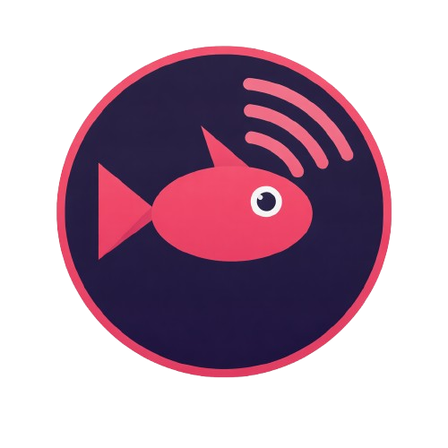

# Unofficial TackleCast-AppImage 🐧

[](https://github.com/Shikakiben/TackleCast-AppImage/actions/workflows/appimage.yml)

<p align="center">
  
</p>

* Upstream: https://github.com/SaltedByte/TackleCast
* [Latest Stable Release](https://github.com/Shikakiben/TackleCast-AppImage/releases/latest)

---

A lightweight, GPU-accelerated capture card viewer (Genki ShadowCast, Elgato,
AVerMedia, and other UVC devices) packaged as a portable AppImage.

AppImage made using [quick-sharun](https://github.com/pkgforge-dev/Anylinux-AppImages/blob/main/useful-tools/quick-sharun.sh), which makes it extremely easy to turn any binary into a portable package without using containers or similar tricks.

**This AppImage bundles everything and should work on any linux distro, even on musl based ones.**

This AppImage can work **without FUSE** at all thanks to the [uruntime](https://github.com/VHSgunzo/uruntime)

This AppImage is also supplied with a self-updater by default, so any updates to this application won't be missed. The self-updater is disabled by default when AppImage managers like [am](https://github.com/ivan-hc/AM), [soar](https://github.com/pkgforge/soar) or [dbin](https://github.com/xplshn/dbin) are present, since those manage AppImage updates.

## Requirements

TackleCast renders exclusively through **Vulkan** (wgpu). There is no OpenGL
fallback, so an AppImage that ships no Vulkan driver cannot display anything.

This AppImage ships **lavapipe** (Mesa's software Vulkan implementation), so it
renders on a machine or VM without a usable GPU driver too, at reduced speed.
The Vulkan backend is selected explicitly (patch 0003), which is what makes the
packaged build reliable: left to `Backends::all()`, wgpu picked a GL adapter and
failed with `Parent device is lost`.

## Capture card permissions

Your user must be able to open `/dev/video*`. If devices exist but are not
readable, add yourself to the `video` and `audio` groups and log back in:

```sh
sudo usermod -a -G video,audio "$USER"
```

Audio goes through ALSA; PipeWire and PulseAudio work via their ALSA
compatibility plugins. If no sound is heard, select the capture card as the
**input** device in the Audio tab instead of relying on the automatic default.

## Patches

Two small upstream patches are applied at build time — see
[`patches/README.md`](patches/README.md):

1. **0001** stores settings and logs under `$XDG_CONFIG_HOME` /
   `$XDG_STATE_HOME` instead of next to the executable, which is a read-only
   mount inside an AppImage.
2. **0002** applies the window icon on Linux (upstream only does it on Windows).
3. **0003** requests the Vulkan wgpu backend explicitly on Linux instead of
   letting wgpu fall back to GL, which cannot render this app's shader.

## Building

The AppImage is built from the TackleCast source tag listed in
`LATEST_VERSION`, using upstream's pinned FFmpeg 8.1.3 recipe (Arch ships
FFmpeg 9, which `ffmpeg-next` 8 cannot compile against).

---

More at: [AnyLinux-AppImages](https://pkgforge-dev.github.io/Anylinux-AppImages/)
